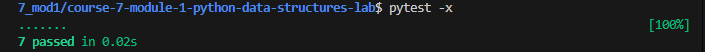

# Student Data Management System

## Overview

This project is a Python-based Student Data Management System that demonstrates the use of Python data structures to organize, filter, and process student records. The application uses lists, tuples, set comprehensions, list comprehensions, and generator expressions to efficiently manage student information.

---

## Features

- Store student records as tuples inside a list.
- Filter students by major using a list comprehension.
- Format student information into a readable string.
- Display all student records.
- Generate a set of unique majors using a set comprehension.
- Lazily generate students by major using a generator expression.

---

## Technologies Used

- Python 3
- Pipenv
- Pytest

---

## Project Structure

```text
student_data.py       # Stores student records
filters.py            # Filters students by major
data_processing.py    # Formats and displays student information
set_operations.py     # Returns unique student majors
data_generator.py     # Generates students lazily by major
```

---

## Installation

Clone the repository:

```bash
git clone https://github.com/Matt20Swanberg/course-7-module-1-python-data-structures-lab
```

Navigate into the project directory:

```bash
cd course-7-module-1-python-data-structures-lab
```

Install the project dependencies:

```bash
pipenv install
```

Activate the virtual environment:

```bash
pipenv shell
```

---

## Running the Tests

Run the full test suite:

```bash
pytest
```

Stop after the first failed test:

```bash
pytest -x
```

---

## Concepts Demonstrated

- Lists
- Tuples
- List Comprehensions
- Set Comprehensions
- Generator Expressions
- For Loops
- f-Strings
- Functions

---

## Screenshots

### Passing Test Suite



---

## Future Improvements

- Allow users to add and remove student records.
- Store student data in a file or database.
- Search for students by ID or name.
- Add additional filtering options.
- Build a command-line interface (CLI) for user interaction.

---

## Author

Created by Matt Swanberg as a part of Course 7 Module 1 (Data Structures in Python 
).